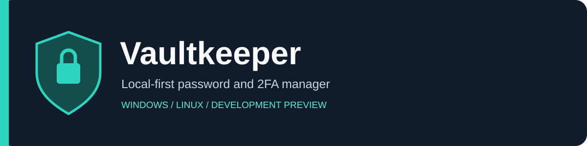

# Vaultkeeper

**Local-first password and two-factor authentication manager for Windows and Linux.**

> Development preview. Not independently security audited. Do not rely on it for sensitive or production credentials until reviewed.

## Features

- Encrypted local vault files, with AES-256-GCM and Argon2id as described in the supplied documentation
- Password management, TOTP codes, password generation and security reports
- Browser extension for Chrome and Edge, local pairing and autofill
- Windows Hello, quick search and automatic locking
- Encrypted attachments, password history, CSV import and automatic backups
- Shared vault files on internal network drives

## Getting started

Windows users can install Python 3.13 and run `build_exe.bat` to build `dist/Vaultkeeper.exe`. Microsoft Edge WebView2 is required.

On Linux, run `bash linux/install.sh` from the project root. Windows Hello is Windows-only; desktop integration varies under Wayland.

## Architecture

| Component | Responsibility |
| --- | --- |
| `vault_core.py` | Vault encryption, TOTP, import and merging |
| `app.py`, `api.py` | Desktop application and UI bridge |
| `bridge.py`, `extension/` | Local browser integration |
| `ui/` | HTML, CSS and JavaScript interface |
| `linux/` | Linux installation and removal |

## Security limitations

No independent security review has been completed. Shared vaults use a common master password and have no individual access audit log. An unlocked vault is exposed to malware on the host. The supplied Linux documentation also notes a disabled Chromium sandbox on Ubuntu 24.04+; this requires review before release.

## Roadmap

- [x] Publish source repository
- [ ] Preserve full original user documentation
- [ ] Review cryptography, browser bridge, sandboxing and data handling
- [ ] Add automated tests and build verification
- [x] Add MIT license for original project code
- [x] Document vulnerability reporting and contribution process

## Community

See [CONTRIBUTING.md](CONTRIBUTING.md), [SECURITY.md](SECURITY.md) and [CHANGELOG.md](CHANGELOG.md).

## License

Original project code is released under the [MIT License](LICENSE). Third-party dependencies and assets remain subject to their respective licenses.
